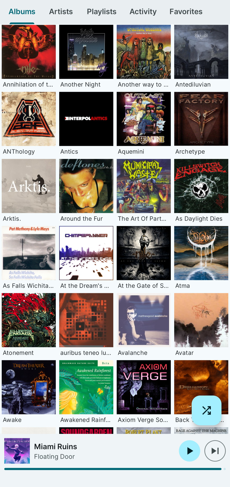
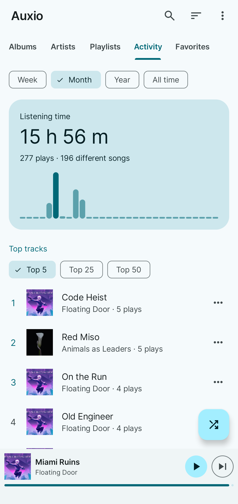
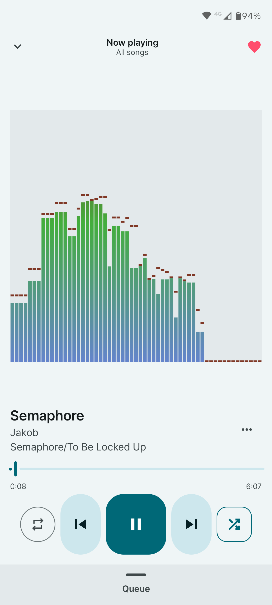
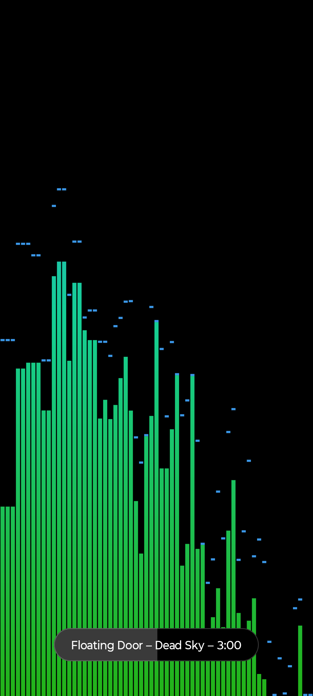

<h1 align="center"><b>Auxio</b></h1>
<h4 align="center">A simple, rational music player for Android.</h4>

    
    
    
    

> **This is a personal fork of [Auxio](https://github.com/OxygenCobalt/Auxio) by Alexander Capehart, based on v4.1.5.**
> It is built for my own use and is not affiliated with or supported by the original project.
> Please don't report issues from this fork to upstream. Original app: [Auxio](https://github.com/OxygenCobalt/Auxio).

## What's different in AuxioPlus

**Visualizer**
- One spectrum visualizer, small in Now Playing and fullscreen on double tap (rotates with the sensor)
- Looks ahead and pulses on drum hits, and waits a little longer on Bluetooth so the bars match what you hear
- Colours are random and change every 1, 2.5 or 5 minutes, or every song

**Fullscreen**
- Tap the middle to play or pause, hold the middle to favorite
- Double-tap left or right for previous or next
- Drag up or down on the left for brightness and on the right for volume, with a level bar
- A pill with the song, a heart for favorites and a trophy for top songs, drag along it to seek

**Palettes**
- 100 hand-picked easter egg palettes in three tiers: rare, legendary and unique
- Each is shown by name when it appears and sparkles more the rarer it is
- A collection in Settings tracks the ones you've found, with a preview you can apply now or for the session

**Library**
- Pinch to zoom Albums and Artists between list, small tiles and big tiles
- Favorites tab with its own sorting, and a heart in Now Playing, the song menu and fullscreen
- No duplicate songs in a playlist, and "Add all to favorites" for playlists

**Activity**
- Listening time, plays and a chart for the week, month, year or all time (weeks start on Monday)
- Top tracks (5, 25 or 50), top artists and top albums for each period
- Trophies for your most played songs: bronze (25 plays), silver (50), gold (100) and diamond (150), shown wherever they play

**Backup**
- One backup folder and one zip with playlists, favorites, activity and discovered palettes
- One restore button that lets you choose what to bring back

## About

Auxio is a local music player with a fast, reliable UI/UX without the many useless features present in other music players. Built off of modern media playback libraries, Auxio has superior library support and listening quality compared to other apps that use outdated Android functionality. In short, **It plays music.**

**The default branch is the development version of the repository. For a stable version, see the master branch.**

## Screenshots

    
    
    
    

## Features

- Playback based on [Media3 ExoPlayer](https://developer.android.com/guide/topics/media/exoplayer)
- Snappy UI derived from the latest Material Design guidelines
- Opinionated UX that prioritizes ease of use over edge cases
- Customizable behavior
- Support for disc numbers, multiple artists, release types,
precise/original dates, sort tags, and more
- Advanced artist system that unifies artists and album artists
- SD Card-aware folder management
- Reliable playlisting functionality
- Playback state persistence
- Android Auto support
- Automatic gapless playback
- Full ReplayGain support (On MP3, FLAC, OGG, OPUS, and MP4 files)
- External equalizer support (ex. Wavelet)
- Edge-to-edge
- Embedded covers support
- Search functionality
- Headset autoplay
- Stylish widgets that automatically adapt to their size
- Completely private and offline
- No rounded album covers (if you want them)

## Permissions

- Storage (`READ_MEDIA_AUDIO`, `READ_EXTERNAL_STORAGE`) to read and play your music files
- Services (`FOREGROUND_SERVICE`, `WAKE_LOCK`) to keep the music playing in the background
- Notifications (`POST_NOTIFICATION`) to indicate ongoing playback and music loading
